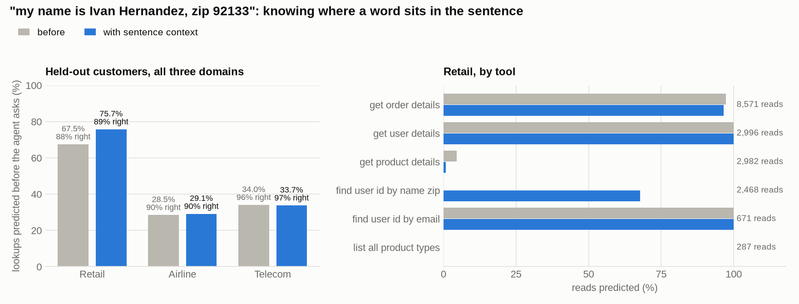
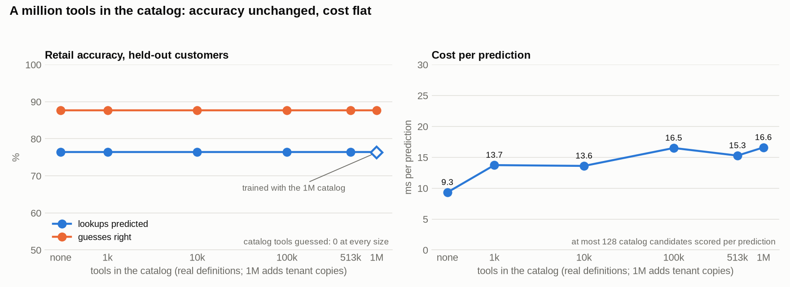

# agent-branch-predictor

Branch prediction for AI agents. When an agent repeats a kind of job, it usually makes the same lookups. This learns that pattern, runs the likely read-only lookups before the agent asks, and hands the results to the model so it can skip steps. Side-effecting tools are never run early.

Built on [QM](https://github.com/yc-software/qm) (agent harness) and [Native](https://github.com/withnative/native) (memory). `bridge.mjs` sits between them; the QM changes are in `patches/qm-native-prefetch.patch`.

**Honest summary.** All numbers below come from my own benchmarks (simulated skills and a simulated business help desk, 10-54 runs per comparison), not production traffic. When the predictor guesses, it is right ~94% of the time; it guesses for about two-thirds of lookups. Prediction alone made turns ~20% faster (9.5s -> 7.4s median). The bigger wins (e.g. 27.7s -> 9.5s) come from the full stack, which adds a fast answer path, thinking off, and tool pruning. On one-off requests, or when tools already take milliseconds, prediction alone does little.

## v3: one predictor for a million tools, specialized per user (2026-11-17)

Everything below v3 trains on each domain's own transcripts. v3 asks the harder question: can one model, trained
once on public data, predict calls on an API it has never seen, out of a million-tool catalog, and then specialize
to a user from a handful of their sessions?

- **Base model** (`bench/zpred.py`): BM25 + server-level retrieval over the 1M catalog, a LightGBM lambdarank ranker
  for the tool, a LightGBM slot model for each argument's value (from the request and earlier results, JSON lists
  included), an include model for optional arguments, and joint (tool x argument set) speculation. Trained on
  ToolBench + ToolACE + multi-turn customer-service transcripts (`bench/calls.py taumt`: tau2-bench airline and
  telecom, tau-bench airline, APIGen-MT-5k airline). **tau-bench retail is left out of every source.**
- **Post-training** (`bench/zadapt.py`, `bench/ztau.py`): from a user's past sessions, call-transition counts and
  frequent values, plus 50 extra boosting rounds on the ranker, slot and include models. 25 sessions take ~5 s on a
  CPU. A "user" here is the deployment: the same agent's sessions with *other* customers (two customer folds,
  `results/ztau/folds.json`), so no customer is predicted by a model that saw their own sessions.

**Offline, tau-bench retail test customers** (replaying the baseline agent's 110 sessions, gate P >= 0.2):

| | lookups ready before the agent asks | attached to its context | precision of attached |
|---|---|---|---|
| Zero-shot (no user data) | 51% | 0% (never confident enough) | - |
| After 25 sessions | 81% | 59% | 92-94% (varies run to run) |

**Live A/B** (solo mode, Claude Haiku 4.5, tools ~0.8 s, same tasks and baseline as `ab3_*` below;
`results/ztau/summary.json`):

| | agent tool calls | turns | input tokens | time | correct (vs baseline) |
|---|---|---|---|---|---|
| v3, run 1 | -41% | -36% | -22% | -15% | 76 vs 78 |
| v3, run 2 | -39% | -34% | -19% | -10% | 81 vs 77 |
| v2 (no distinct-value fix) | -39% | -34% | -17% | -10% | 83 vs 78 |
| domain-trained (`ab3`, below) | -50% | -44% | -29% | -8% | 79 vs 74 |

Pooled over the two v3 runs, accuracy moves +0.9 points; the one-sided 95% lower bound (-5.3) does not certify the
-3-point non-inferiority margin, and identical baseline runs disagree on 5-10 tasks, so read it as "unchanged within
noise", not as a gain. Cost: -6% and -3%.

**Picking the tool out of a million, on real agents** (`bench/zmt.py`, `results/zpred/mt_catalog.json`): the held-out
test conversations of the multi-turn data (tau2 airline + telecom, 3,267 calls), the 1M catalog attached and the
agent's tool list hidden. Each domain is one user, its conversations split in two folds; a fold is predicted after
post-training on H conversations of the other.

| history | right tool in 3 guesses | exact call in 3 | first call: tool / exact | telecom / airline (tool) |
|---|---|---|---|---|
| 0 (zero-shot) | 44% | 28% | 9% / 4% | 47% / 39% |
| 5 sessions | 77% | 55% | 98% / 96% | 86% / 63% |
| 25 sessions | 79% | 64% | 99% / 97% | 88% / 66% |

Embedding retrieval (Qwen3-Embedding-8B over all 1M tools, `results/zpred/run_emb_spec3_k50.json`) added ~1-2 points
on ToolBench's 1M catalog at 9x the latency (300 ms vs 33 ms), so it stays off. Many ToolBench misses are calls the
request never asks for (synthetic queries over randomly sampled APIs), a ceiling no retriever lifts.

**ToolBench, held-out APIs** (`bench/zeval.py`, `results/zpred/eval_toolbench.json`, 18,549 calls, one of 3
prefetched calls is an exact later call): 48.8% with the session's tools known, 31.6% from the full 1M catalog.

Limits: the 25-session history and the 0.2 gate were picked on an offline replay of the same test customers' baseline
sessions; the live runs are separate and cross-fit. A zero-shot live run is not done yet. The live transcripts are
not committed (`*.jsonl`), only their summary.

## v2: learned predictor on real chat transcripts (2026-11-05)

The hand-learned rule table is replaced by a learned model (`bench/gpred.py`), chosen after a literature review (`reports/Agent tool call prediction.md`):

- **Architecture.** No LLM in the loop. After every tool result and every customer message, each read tool's argument is paired with every candidate value (fields of earlier results, id-like tokens and dates in the customer's words, names mapped to codes through alias tables learned from table-shaped results, e.g. "New York" -> JFK). A LightGBM classifier scores each candidate on generic features (field vs argument name, recency, list position, how many places the value appears, what the agent already opened, call history). ~5 ms per prediction on CPU; per-guess SHAP explanations are computed after the lookups start, so nothing waits on them.
- **Two gates.** A per-tool Wilson lower bound on precision, picked out of fold. Strict guesses (score >= 0.9, at most 3 per lookup) are attached to the agent's context; looser ones only prefetch into a cache, so a wrong one costs a wasted read, never a wrong record in front of the model. Only read-only tools are ever predicted.
- **Data.** 6,398 real multi-turn chats (tau-bench + tau2-bench public trajectories; 6 agent models: GPT-4o, GPT-4.1, Claude 3.5 Sonnet, 3.7 Sonnet, Sonnet 4.5, Opus 4.5). The predictor only sees what the customer has said so far. Splits are by customer. The tau2 trajectories are not redistributed here (`bench/traces.py` documents where to get them).

**Held-out customers** (`bench/gpred.py within`):

| Domain | Attached to context | Precision | Ready before the agent asks (either gate) | Head start (median) |
|---|---|---|---|---|
| Retail | 66% of lookups | 88% | 80% | 3.8 s |
| Telecom | 38% | 97% | 99% | 4.1 s |
| Airline | 29% | 90% | 57% | 4.1 s |

Unseen agent models (retail): Opus 4.5 97% precision / 52% coverage, GPT-4.1 88% / 62%. A domain with no traces at all does not work; each domain trains on its own common requests.

**Live A/B, solo mode, tools at ~0.8 s** (`bench/tau_live.py`, `ab3_*`): the agent issues 50% fewer tool calls itself (7.5 -> 3.7) and takes 44% fewer turns; total lookups executed stay about the same (7.5 -> 7.8), they just move from the model's serial loop into parallel prefetch; cost -11% per task (cache reads fall, cache writes barely move because attached records are new content), time -10% on tasks both arms answered correctly. Accuracy rule: prediction may not be worse, tested as non-inferiority (one-sided 95% lower bound of the paired accuracy difference above -3 points). Attaching every guess passed (-2.4) but four tasks the baseline always gets right regressed (too many records in context); attaching less clears most of them at the price of most of the savings. Identical baseline runs themselves flip 5-10 answers, so verdicts need several runs per task; that is the next experiment.

**Multi-turn live A/B** (`bench/tau_chat.py`, tau-bench's user simulator played by Sonnet 4.5, agent Claude Haiku 4.5, all 115 test tasks, two identical baselines for the noise floor): baselines 83 and 84 correct, and even they put the one-run lower bound at -5.0 points, so certifying a -3 margin needs several runs per task. Safe mode (cache only, agent inputs unchanged) 88 correct, lower bound -3.3, 4% faster. Turbo (attach >= 0.9, at most 3 records, trimmed) 82 correct, lower bound -8.0, agent-issued tool calls -30%, turns -16%, agent cost per conversation -5% ($0.0450 -> $0.0427, priced with per-token rates recovered from the CLI's bills for the solo runs, which reproduce all 456 of them exactly): not certified yet. An earlier multi-turn run was discarded because the CLI exposed the account owner's email to the agent; runs now use an empty `CLAUDE_CONFIG_DIR`.

**Sentence context** (2026-11-13, now the default): a call that takes several arguments is assembled from the best value for each argument, and a word from the customer's text carried nothing about where it sat in the sentence. In "my name is Ivan Hernandez, zip 92133" the model could not tell Ivan from Hernandez from "Sure", so `find_user_id_by_name_zip` (14.5% of retail reads) was never predicted. Four features per text word fix it: the word before it (hashed per argument, categorical), whether the neighbouring words have its shape, and how many same-shape words came before it. Held-out customers, same folds and gates (`bench/dump_traces.py`, `bench/gate_eval.py`, `results/gate/context.json`): retail 67.5% -> 75.7% of lookups predicted at 88.2% -> 88.8% precision (calls saved 50.3% -> 56.5%; name+zip 0% -> 68%), airline 28.5% -> 29.1%, telecom 34.0% -> 33.7%. Airline flight searches stay out of reach: agents pick destinations to try on their own. Through prefetchd (60k calls, 16 shards, models retrained by `bench/longctx.py`): ready ahead 80.0% -> 83.7%, attached 52.9% -> 56.8% at 74.3% -> 73.8% precision, 0 mismatches, about +1.3 ms per prediction (`abl_ctx*.json` vs `abl_base3.json`, run back to back). Models saved before this load with the features off and predict exactly as before.



**Live, the gain is latency, not turns** (`results/live_chat4.json`, 115 multi-turn retail tasks, same setup as the multi-turn A/B below, fresh baseline and the old models side by side): with attaching on (turbo), both predictor arms cut the agent's own tool calls 31% and turns 17%, input tokens 11%, wall time unchanged. The context models prefetched the name+zip lookup 66 times; the agent still made it itself (the policy has it authenticate the customer through the tool), but 60 of those 96 calls came from the cache in 0.3 ms instead of 0.8 s. Turbo cost accuracy, beyond the noise floor this time: 79 and 81 correct against 89 (one-sided 95% bounds -16 and -14 points, base-vs-base -5). Cache-only mode, which never changes what the agent sees, is the mode to ship.

**Self-improvement** (`bench/improve.py`): the first search kept one structural change (features for how ambiguous each argument is). On untouched test customers telecom went from 36% to 40% of lookups attached at the same 93% precision; retail and airline unchanged.

**Several catalogs, one predictor** (`bench/union.py`, `results/scale/union.json`): retail, airline and telecom read tools in one 17-tool catalog (both retail and airline have a `get_user_details`, with different results) vs one predictor per domain, same customer folds. Retail 88% precision / 66% coverage (separate: 88% / 67%), telecom 95% / 33% (97% / 34%), airline 88% / 41% (90% / 28%): merging catalogs costs about a point of precision, and airline gains coverage from what the other domains teach.

**Lookalike tools** (`bench/scale.py`, `results/scale/`): 30 decoys copying retail's argument names and value shapes under near-identical names, forced into the catalog. No decoy ever fired, but coverage fell from 67.6% to 38.9%. Not from the harder negative subsampling the bigger catalog needs (same rate, no decoys: 63.1%): the never-called decoys inflate scores on the real tools, so their wrong guesses at >= 0.9 multiply (get_product_details 556 -> 5,285 on one fold, `retail_decoy_probe.txt`) and they fail their precision gates. The shipped predictor cannot get there: a tool enters its catalog only once agents have called it in training. Untested: lookalikes that agents do call now and then (v1 and v2 of one API).

The prefetch sidecar (`bench/tau_chat_mcp.py`) survives its own failures: state.json is updated under a file lock (runner and per-turn server both write it), a prefetch whose owner process is gone is not waited on, a read that raced a write is never served (write generation), at most MAX_PREFETCH guesses run per prediction; `bench/test_sidecar.py` checks each case.

**Also here:** `bench/tau_chat.py` (multi-turn live runs with tau-bench's user simulator, timestamped traces, "safe" cache-only mode that cannot change the agent's inputs), `bench/improve.py` (worst-case-driven structural search on validation customers, scored once on untouched test customers), `bench/prune.py` (learned field trimming for attachments: telecom attachments -52%, retail/airline -13%, 99.9% of later-used values kept, ~20-40 us per record).

## prefetchd: the predictor as a service, 1M real tool calls (2026-11-11)

`bench/prefetchd.py` runs the predictor as a long-lived service over real tools: tau2-bench's own retail, airline and telecom environments, their databases and tool code, writes included (`bench/realtools.py`; a fresh replay reproduces 100% of recorded retail and airline reads, 96.6% of telecom's, whose customer also changes device state with tools that are not replayed). The agent sends customer text and tool calls over HTTP; a predictor thread per shard guesses the next reads after every event and an IO pool runs them. Every write bumps a generation that drops the cache and any guess computed before it; prefetches are never writes (tau2's own mutating flag decides). Memory per session is bounded: a window of recent reads, a text tail, an LRU cache, LRU session eviction.

`bench/workload.py` drives it with the recorded trajectories chained 50 tickets per session (sessions run to ~500 calls, far past the 7-20 the model was trained on), each ticket on its task's own starting state, and checks every answer against a shadow environment that runs the same call directly.

**1,030,755 real tool calls** (8 shards, 120 concurrent client threads, 0.2 s think time, `bench/results/prefetchd/run_1m.json`):

| | |
|---|---|
| Wrong results served | **0** (571k served from prefetch) |
| Reads ready before the agent asked | 71.7% (73.0% in a session's first 20 calls, 71.2% at calls 100-500) |
| Reads attached to context | 40.9%, 77% precision |
| Prefetches used | 46% |
| Throughput | 220 calls/s, 0 errors |
| Server time per call | p50 0.13 ms, p99 1.8 ms |
| Memory | 1.24 GB max per shard |

The limit is the predictor's queue: p99 lag 1.4 s under load, so some reads arrive before their guess is made. Prediction is 78% Python feature building (GIL-bound), 12% LightGBM; caching four pure helpers cut it 31% with identical output.

**Does the service need to know where a ticket ends?** 300k-call runs, models trained on the service's own bounded view (`bench/longctx.py`: last 8 reads, last 1,500 characters, each training chat also replayed after 1-3 other chats of the same customer fold):

| | Ready before asked | Attached | Attach precision |
|---|---|---|---|
| Told where each ticket starts (memory reset) | **76.7%** | **50.4%** | 73.6% |
| Never told (one unbroken session) | 66.2% | 25.4% | 42% |
| Never told, models trained on single chats | 63.4% | 29.5% | 23% |

Told, it beats the 1M run (71.7% ready, 40.9% attached at 77%). Never told, prefetching still works (a cached result is only served when the agent issues that exact call, so it is never wrong) but attachments pick up the previous customer's records: run such a deployment cache-only. Two rules got it there. After a write, only reads sharing an argument value with it (cancel order X: reread order X) become predictable again, instead of everything; before, one unbroken telecom session fell to 11% ready because rereads were never predicted, and making all of them predictable sank attach precision to 25%. And a predicted reread is prefetched but not attached, since the agent already saw that record.

**Very long sessions** (250 tickets chained, ~2,500 calls per session, 312k calls, `long_sessions.json`): ready ahead 77% in a session's first 500 calls, 76.5% at calls 500-2,000, 72.6% past 2,000; attach precision 73.6%; 918 MB per shard, 0 mismatches. A domain with no trained model is served unpredicted rather than refused.

**Scaling out** (`shards16.json`): prediction is one GIL-bound thread per shard, so shards are the knob. 16 shards instead of 8 on the same 24 cores: ready ahead 79.9%, 243 calls/s, queue lag p50 0.15 ms / p90 47 ms / p99 329 ms (8 shards: 7 / 172 / 701 ms), client call p50 6.4 ms, 882 MB per shard. The remaining tail is harness cost, measured: every ticket builds a fresh tau2 environment inside the shard (airline ~95 ms of JSON parsing and pydantic validation, holding the GIL). An ablation whose shards never rebuild (`bench/ablate_nobuild.py`, results wrong on purpose) cuts queue lag p99 from 174-233 ms to 20 ms and p90 from 27-34 ms to 4 ms (60k calls each, 16 shards: `abl_base.json`, `abl_base2.json`, `abl_nobuild.json`). A deployment over a shared database builds none. Cheaper builds don't help: cloning a validated database by deepcopy or pickle costs 2x a rebuild.

`python3 -I bench/test_prefetchd.py <tau-bench>` checks the invariants on real retail tools: prefetched results equal direct ones, writes invalidate, a write during a prediction drops its guesses, writes are never prefetched, memory stays bounded over 1,500 calls, a crashing predictor does not stop the service.

## A million tools (2026-11-13)

The predictor was built for catalogs of 5-20 tools. `docs/million-tools.md` is the checklist of what changes at a million, with the decision and status of each item. The premise every choice leans on: a session never sees a million tools, it is connected to a few servers; the million exists at the service. Per prediction, work must follow the conversation, never the catalog.

**The catalog** (`bench/catalog.py`, sources fetched by `data/catalogs/fetch.sh`, parsed as data only): 275k distinct real tool definitions from APIs.guru's OpenAPI directory (130k), ToolBench/StableToolBench RapidAPI (47k, GET endpoints only), Google API discovery (31k), Azure REST specs (27.5k), Microsoft Graph v1.0 (20k) and AWS botocore (19.6k). Public catalogs top out there; counting every API version (as gateways serving versions side by side expose them) gives 513,837. The 1M catalog is those plus 486,163 tenant copies (the same API registered under other tenants' server names, as a multi-tenant gateway would), labelled as such.

**Candidates without scanning the catalog** (`bench/toolindex.py`): every catalog argument is indexed under (value class, name token): email, date, uuid, url, integer, id, code or word, from its schema or name, and the tokens of its name. A value in the conversation is looked up with its own class and the names around it (its result field and tool, or the last words before it in the customer's text), best 16 slots per value, at most 128 catalog candidates per prediction. Tools known only from a schema never earn their own gate; they can only clear a pooled gate certified on tools like them.

**Retail with a million tools in the catalog** (`bench/catalog_scale.py`, `results/catalog/scale.json`; held-out customers, gates re-picked with the catalog attached):

| Catalog | Precision | Lookups predicted | Catalog tools guessed | ms per prediction | Index build |
|---|---|---|---|---|---|
| none | 87.7% | 76.5% | 0 | 9.3 | |
| 1k | 87.7% | 76.5% | 0 | 13.7 | 0.0 s |
| 10k | 87.7% | 76.5% | 0 | 13.6 | 0.1 s |
| 100k | 87.7% | 76.5% | 0 | 16.5 | 1.2 s |
| 514k (all real) | 87.7% | 76.5% | 0 | 15.3 | 5.4 s |
| 1M | 87.7% | 76.5% | 0 | 16.6 | 10.4 s |
| 1M, trained with it | 87.7% | 76.3% | 0 | 14.8 | |

Accuracy does not move, nothing from the catalog fires, and the cost is a flat ~6 ms once the candidate cap is reached. Training with the million tools as negatives changes nothing either (unlike forced-in lookalikes of the real tools, `results/scale`).



**Partitioning and forwarding** (`bench/router.py`, `bench/test_router.py`): servers used together are grouped (union-find over co-use) and packed onto partitions, each with a shard group sized to its load. Stateful servers (a tau domain's database) are never split; stateless catalog servers bigger than half a partition are cut by tool name. 1M tools on 25,631 servers into 64 partitions: every partition at exactly 1/64 of the load, planned in 0.2 s. A partition's share of the index is small (16 partitions: 31-32k read tools each), and `router.py shard-catalog` writes one file per partition so no shard parses the rest. The router is stateless (the shard is written into the session id, so any number of routers share one port): a session goes to the partition holding most of its servers, a tool owned by another partition is executed there, a dead shard answers 503 `reopen` and new sessions avoid it.

**The service with a million tools** (`results/catalog/svc_*.json`, 60k real tool calls each, 16 shards, back to back; the tau domains are stateful partitions with 8/4/4 shards, the 1M catalog's 16 stateless partitions are hosted round-robin on the same shards, every result checked against a direct call):

| | Calls/s | Ready ahead | Attached (precision) | Client p50 | Predict p50 | Queue lag p99 | Memory per shard | Wrong results |
|---|---|---|---|---|---|---|---|---|
| Direct to shards | 184 | 83.8% | 56.8% (73.7%) | 6.8 ms | 8.0 ms | 252 ms | 730 MB | 0 |
| Through the router | 181 | 83.3% | 56.3% (73.5%) | 7.5 ms | 11.9 ms | 132 ms | 781 MB | 0 |
| Router + 1M-tool catalog + 10% calls to catalog tools | 173 | 81.6% | 54.7% (73.1%) | 10.1 ms | 23.6 ms | 424 ms | 857 MB | 0 |

The router hop costs 0.7 ms at p50 and 2% throughput. With the million-tool catalog attached to every predictor, the service keeps 0 wrong results and its throughput within 6%; readiness slips 2 points because each prediction now also scores up to 128 catalog candidates, so prefetches start later (queue lag). The 6,188 calls to catalog tools on other servers were all forwarded to the shards owning their partition and executed there (stub upstream: there is no real backend for 500k public APIs in this harness), 0 wrong, 103 ms mean under load. No catalog tool was ever prefetched: only tools on a domain's read allowlist are run ahead of time.

## Live agent on tau-bench retail (Claude Haiku 4.5)

`bench/tau_live.py` runs a real agent (Claude Haiku 4.5 through the Claude Code CLI, tau-bench's retail policy, the benchmark's tools served by `bench/tau_mcp.py`) in solo mode on all 500 retail train tasks and 115 test tasks, recording every tool call.

**Prediction vs. what the agent actually did** (`bench/tau_live_nested.py`: nested 5-fold CV over test-task customers; each fold trains on the 500 train traces plus the other folds and picks its settings by inner CV, so no fold is scored by rules that saw its customers):

| Mode | Guesses right | Reads predicted before the agent asked | All tool calls the model would not need to issue |
|---|---|---|---|
| Strict (earlier tool results only) | 98% | 47% | 38% |
| Text (also the customer's request) | 84% | 64% | 51% |

Training on train-task traces alone fails (5% coverage): every train request quotes the order number, so the agent never shows the test-style flow (user -> account -> every order). The predictor only predicts patterns it has seen.

**End-to-end A/B** (`bench/ab_compare.py`, text mode, per-fold rules, both arms run side by side on the same 115 test tasks, 106 paired; bootstrap 95% CIs):

| | Baseline | With prediction | Change |
|---|---|---|---|
| Tool calls the agent issued | 7.5 | 3.9 | **-47%** (-52..-43) |
| Model turns | 8.5 | 4.9 | **-42%** (-46..-38) |
| Input tokens | 68.7k | 53.6k | **-22%** (-26..-18) |
| Output tokens | 2,340 | 2,185 | -7% (-13..-1) |
| Wall time | 23.5s | 22.0s | -7% (-12..-1); median 22s -> 19s |
| Write actions match the answer key | 73/106 | 75/106 | no loss |

## Standard benchmark: tau-bench (offline replay)

`bench/tau_replay.py` replays [tau-bench](https://github.com/sierra-research/tau-bench)'s ground-truth tool-call sequences (retail 115 test tasks, airline 50) against the benchmark's own data. Users are split in half: all tuning used 5-fold cross-validation on one half (`bench/sweep.py`, `bench/tau_diag.py`), and the other half was scored once with the locked settings. Only read calls are predicted. "Strict" uses earlier tool results only; "text" may also use the customer's words (approximated by the task instruction, so it is optimistic).

Holdout half (never used for tuning):

| | Retail guesses right | Retail lookups predicted | Retail calls saved | Airline guesses right | Airline lookups predicted | Airline calls saved |
|---|---|---|---|---|---|---|
| v1 strict | 86% | 51% | 35% | 41% | 38% | 21% |
| v1 text | 76% | 52% | 36% | 41% | 47% | 26% |
| v2 text | 75% | **63%** | **43%** | 13% | 44% | 24% |

v2 adds looser ID patterns, a filter for list entries the customer mentioned, one-word triggers per rule, and Wilson lower-bound rule scoring. It holds up on retail (+11 points of coverage at the same precision) and fails on airline: a loose text pattern that looked fine on 30 tuning tasks fired 125 wrong guesses on the 20 holdout tasks. Airline is too small to tune on.

Precision here is a lower bound: tau-bench's answer key lists a reference set of calls, and real agents also make reads it leaves out (e.g. user lookups before a change). The replay has no model in the loop, so it measures prediction only, not time or tokens. Logs: `bench/results/`.

## Run

```
./run.sh            # bridge on :8787, QM on :8080 (QM checkout on branch native-prefetch)
```

Copy `env.example` to `env.local` to set the mode; set `QM_DIR` to a QM checkout with the patch applied and `NATIVE_BIN` to a built Native `mcp-stdio`. Model auth is the Claude subscription token in `claude.token`; `run.sh` refuses API keys.

| Variable | Values | Default |
|---|---|---|
| `PREDICTOR` | `off`, `shadow` (predict + score only), `speculate` (run predicted reads in the background, serve matching calls from cache), `inject` (speculate + hand finished results to the model as live data) | `speculate` |
| `SIM=1` | expose the simulated skills (`sim.mjs`); the author's personal `REAL` tools are not published | off |
| `NATIVE_DB` | Native SQLite file | `native.db` |
| `PREDICTOR_THETA`, `PREDICTOR_TAU` | history confidence / request similarity | 0.7 / 0.5 |
| `CLASSIFIER_THETA` | distilled-classifier confidence | 0.5 |
| `PREDICT_SCOPE` | `calls` (predicted calls only) or `entity` (also every other read-only skill for the detected entity) | `calls` |
| `LIVE_WAIT_MS` | how long inject waits for predicted results | 1500 |

## How the predictor works

1. Every turn's tool calls are stored in Native as a `tool-trace` record.
2. At turn start (QM's recall call carries the user text), predict the read-only calls:
   - **history slots**: past turns with similar wording, calls stored as templates with the entity slotted (`real_jobs_log(company=$E)`), filled with this request's entity;
   - **distilled classifier** when history has nothing: TF-IDF + logistic regression trained on 1,740 requests Haiku 4.5 wrote for every 1-3 tool combination (`eval/distill.py`, `eval/train.py`), args from per-tool habits.
3. `speculate` starts the calls immediately and serves a matching model call from the cache; any write clears the cache. `inject` also puts finished results in the prompt, so the model can skip a step.

## Results (eval/)

| Test | Result |
|---|---|
| Ad-hoc Claude Code transcripts | exact next call predictable ~2%; not a target |
| Sim skills, Sonnet, speculate | precision 94%, median turn 12.8s -> 9.8s |
| Real workflow (job log + repos), speculate | precision 95%, no speedup: tools take 5-12ms |
| Real workflow, inject | model calls 2.6 -> 0.55/turn, ~1s faster |
| Real workflow, Haiku 4.5 + inject | median 10.9s -> 8.5s, 17/20 faster, 8/8 cap answers correct |
| Haiku zero-shot as predictor | 92-97% precision, 67-70% coverage, 2.5-3s |
| Distilled classifier, no history | real 82% precision / 93% coverage |
| **Cold start (empty DB), Haiku 4.5 + inject** | **median 9.5s -> 7.4s, 18/20 faster, 19/20 turns predicted, 8/8 cap answers correct** |
| Business desk (CRM/billing/support/usage SQL + live Wikipedia, 42 real-company accounts), Haiku 4.5 + inject | median 13.3s -> 12.7s (paired median -1.5s, 15/23 faster), model tool calls 3.1 -> 1.1/turn, 24/24 correct both arms; unseen accounts 11.5s -> 7.7s |
| Business desk, full-set (`PREDICT_SCOPE=entity`: prefetch every read for the account) | 19/24 turns with zero model tool calls (seen 14/14), 24/24 correct, but median 14.0s vs baseline 14.3s: replies got 24% longer |
| Business desk, full set with extras labeled "background" | 19/24 zero-call turns, replies +6% shorter than unlabeled full set, median 13.3s vs baseline 14.2s (paired -0.5s, 15/24 faster), 24/24 correct. Best overall remains `PREDICT_SCOPE=calls` (12.7s). Run-to-run baseline noise ~1s at n=24 |
| Research desk (live HN search + page fetch), chained speculation, interleaved A/B n=30 | 76 fetches served from cache (32% of 237 speculated), turn diff -0.3s (95% CI -2.0..+1.3): no effect |
| Research, `augment` (attach top-3 follow-up pages to the search result) | model skipped fetching on 15/30, but +1.5s (CI -0.3..+3.4): the 3s wait and bigger context cost what the skipped step saved |
| Turn profile (Haiku, medians) | business 13.4s = first step 4.8 + tools 0.3 + between-step model 0.3 + final answer 5.7; research 17.9s = 3.3 + 1.4 + 4.5 + 7.6 |
| QM warm Claude process pool (`CLAUDE_WARM_POOL=1`, keyed by launch shape) | first step faster on 13/16 asks (mean -0.19s, CI -0.96..+0.57), total -0.83s (CI -1.98..+0.32); standalone SDK test: 1.9s -> 0.9s |
| Side query | QM's session-title generation on the default model (Opus 5), fire-and-forget, once per new conversation; not on the critical path |
| Streaming TTFT A/B (business, Haiku, interleaved, 54 pairs over 2 runs) | **inject cuts total turn time: mean -2.42s (95% CI -3.89..-0.96), median -3.2s, faster 41/54**; first-text time unchanged (-0.18s, CI -1.78..+1.43) |
| Low effort (`thinkingLevel: low`) on inject turns | no effect (ttft +0.44s, CI -0.55..+1.43) |
| Full-set scope vs predicted calls (warm pool on) | full set +2.5s slower than calls scope (CI -1.8..+6.8); calls scope stays default |
| Warm pool, streaming | off-arm first text 7.8s (no pool) vs 5.0s (pool on), different runs: indicative only |
| **Fast path** (bridge marks confident turns; QM runs a lite Haiku turn: no tools, thinking off, short prompt) | business median 16.3s -> 4.3s, -7.39s (CI -9.81..-4.97), 29/30 faster; fired 14/30 |
| **Fast path, full account (loose)** (`PREDICT_SCOPE=entity FAST_PATH=1 FAST_LOOSE=1`) | fired 30/30; mean 14.1s -> 4.6s, -9.41s (CI -11.30..-7.52), first text 4.6s -> 1.0s, faster 30/30, 29/30 correct |
| Deep prefetch on multi-step portfolio reviews (list, then every account) | median 28.4s -> 15.6s, -8.58s (CI -11.91..-5.24), 14/15 faster |
| Hidden thinking | Haiku adaptive thinking costs 1.3-5.8s before the first text on every normal turn |
| **Final: portfolio reviews, deep prefetch + loose fast path** | fired 15/15; median 30.4s -> 8.3s (-21.2s, CI -25.1..-17.2), first text 3.9s -> 0.9s, input tokens 127k -> 5.4k (23x), output 3.6k -> 0.7k, cost -55%, 14/15 correct |
| **Final: single-account, loose fast path** | fired 15/15; median 14.3s -> 6.3s (-7.3s, CI -9.2..-5.4), first text 5.3s -> 0.9s, input tokens 80k -> 2.5k (32x), cost -65%, 15/15 correct |
| **No-think on inject turns** (`+nothink`; tools still available) | median 11.3s -> 5.8s (-4.7s, CI -6.1..-3.3), first text 5.4s -> 1.4s, output tokens 1064 -> 382 (-64%), cost -20%, 20/20 correct, faster 20/20 |
| **Compact injected data** (`+compact`: JSON arrays -> header + rows) on the loose fast path | median 6.3s -> 5.4s (-0.91s, CI -1.36..-0.46), input tokens 2497 -> 2060 (-18%), cost -12%, correctness unchanged |
| **Full stack** (`inject+entity+deep+fast+loose+compact+nothink+prune`), single-account | median 15.3s -> 5.6s (-8.4s, CI -10.0..-6.7), first text 4.1s -> 0.9s, input tokens 80k -> 2.0k (39x), cost -69%, 15/15 correct |
| **Full stack**, portfolio reviews | median 27.7s -> 9.5s (-18.2s, CI -22.5..-13.9), first text 3.7s -> 1.4s, input tokens 126k -> 7.3k (17x), cost -50%, 10/10 correct (baseline 9/10) |
| Per-turn tool pruning (`+prune`) on non-fast inject turns | input tokens 40k -> 17k (-58%) but cost UP ($0.0173 -> $0.0202): a per-turn tool list breaks the prompt cache. Rerun (3-way, 20 pairs): per-turn prune 40k -> 16k tokens, cost -27%; family `+prunefam` 40k -> 18k (-54%), cost -13%, 20/20 correct; time -1.0s (CI -2.4..+0.4). Cost penalty in the first run was cold-cache noise. Default to `+prunefam` |
| **Answer memo** (`+memo`; QM keeps fast-path answers keyed by model + prompt + fetched data, 10 min) | repeat requests 5.47s -> 0.18s, 0 tokens, $0, 15/15 hits, 15/15 correct |

Default `env.local` now runs the whole stack: inject + entity scope + deep prefetch + loose fast path + compact + no-think + family pruning + memo, Haiku, warm pool.

Limits: one active turn at a time (no session id reaches the bridge); entities must be in a tool enum, the job log, or past calls; prediction covers tools that pass through the bridge (Native, real, sim), not QM's built-ins.
